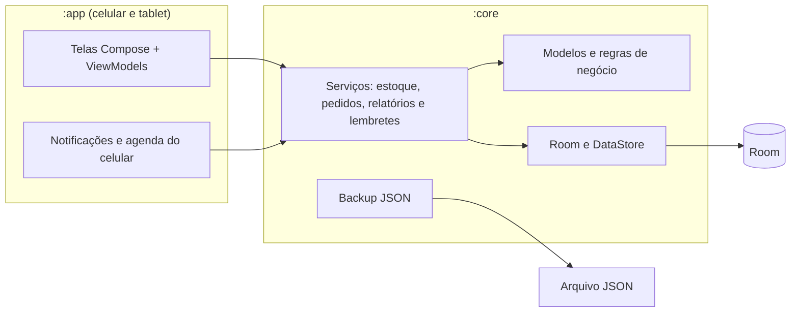
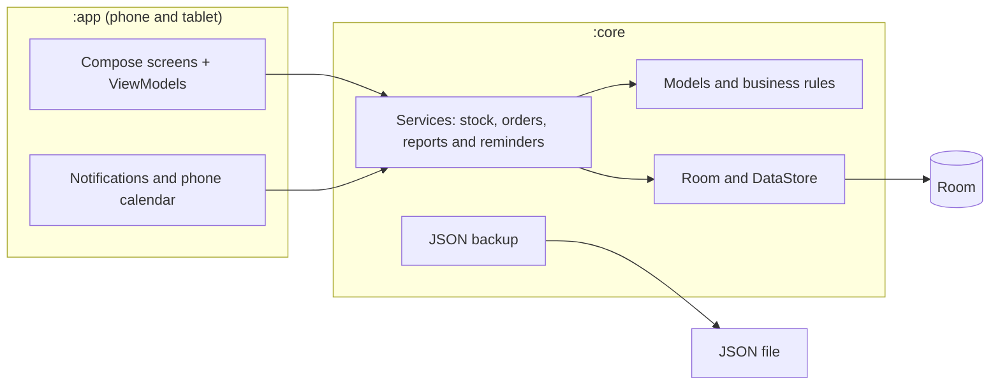

# &nbsp;&nbsp;TinyStock&nbsp;

**[Read in English](#en-tinystock)**

_Organize estoque de produtos, pedidos e vendas do seu pequeno negócio._

O TinyStock foi criado para pequenos negócios feitos à mão, como o crochê da minha mãe e meus produtos impressos em 3D, cujo estoque já não cabia numa planilha.

Cadastre seus produtos com custo de produção e preço. Cada venda vai para um calendário, e os relatórios mostram quantas vendas você fez e quanto lucrou.

Dá para ter mais de uma loja, cada uma com seus produtos, e as notificações avisam o que precisa de atenção.

Tem as mesmas funções da [versão iOS](https://github.com/jonathaxs/tinystock-ios) e é gratuito, sem anúncios, sem assinatura e sem cadastro.

**Disponível em [APK](https://jonathasmotta.com/downloads/TinyStock-1.0-beta.apk)** para Android, com layout para tablets e dobráveis.

## Funcionalidades - Versão 1.0 beta

**Lojas**
- Várias lojas independentes, com troca rápida entre elas.
- Arquivamento e lixeira com restauração por 30 dias.

**Produtos e estoque**
- Produtos com foto, preço de venda, custo e lucro por unidade.
- Variações opcionais (cor, tamanho, modelo), cada uma com seu próprio saldo.
- Toda alteração de estoque gera uma movimentação registrada, o que permite auditar entradas, saídas e ajustes.

**Pedidos**
- Pedidos de pronta entrega ou para produção.
- Canais de venda: venda direta, Shopee, Mercado Livre ou outro canal personalizado, com cálculo de taxas.
- Fluxo de status: novo, aguardando produção, em produção, pronto para envio, enviado, concluído ou cancelado.
- Baixa automática do estoque e registro do retrato financeiro de cada pedido (preço, custo e taxa no momento da venda).

**Calendário e lembretes**
- Calendário interno com prazos de produção e despacho, filtros e atalhos.
- Notificações locais de produção e despacho.
- Exportação dos compromissos para o app de agenda do celular.

**Relatórios**
- Receita, custos, taxas e lucro líquido por loja e período.
- Desempenho por canal de venda e produtos mais vendidos.

**Dados e personalização**
- Backup em JSON para exportar e importar, compatível com a versão iOS.
- Backup automático do Android na Conta Google, conforme os ajustes do aparelho.
- Cores de destaque configuráveis.
- Interface em Português do Brasil e English, conforme o idioma do celular.
- Suporte a TalkBack, tamanho de fonte do sistema, modo claro e modo escuro.

## Arquitetura



- **Kotlin** e **Jetpack Compose** com **Material 3** em toda a interface, no padrão **MVVM**: cada área tem sua ViewModel, e o estado flui por `StateFlow`.
- Uma tela Início com o resumo da loja e o catálogo. Relatórios, Calendário e Ajustes abrem como páginas, com **Navigation Compose**.
- Layout adaptado a tablets e dobráveis, com a lista ao lado do conteúdo e atenção à dobra da tela (**Jetpack WindowManager**).
- **Dois módulos Gradle**:
  - `:core` tem domínio, regras e persistência, sem interface;
  - `:app` é o app, com as telas e a integração com o sistema.
- **Room** para lojas, produtos, estoque e pedidos; **DataStore** para as preferências.
- **kotlinx.serialization** para o backup, no mesmo formato da versão iOS.
- **WorkManager** para os lembretes de produção e despacho.
- **BigDecimal** em todos os valores monetários, evitando erros de arredondamento.
- Os textos vêm da versão iOS, importados por um script, para os dois apps dizerem o mesmo.
- Testes unitários com JUnit, concentrados no `:core`.
- Nenhuma biblioteca de terceiros além do Jetpack e do Kotlin.

## Estrutura do repositório

```text
TinyStock/
├── core/                      Domínio e persistência, sem interface
│   └── src/main/java/.../core/
│       ├── model/             Lojas, produtos, variações, estoque e pedidos
│       ├── service/           Regras de estoque, pedidos, lembretes e exportação para a agenda
│       ├── report/            Resumo da Início e relatórios por período
│       ├── data/              Banco Room, DAOs e preferências no DataStore
│       ├── backup/            Formato, leitura e validação do backup JSON
│       ├── format/            Formatação de moeda
│       └── util/              Utilitários comuns
├── app/                       App Android
│   └── src/main/java/.../
│       ├── ui/                Telas por área: Início, Produtos, Calendário, Relatórios, Ajustes e boas-vindas
│       └── notifications/     Lembretes com WorkManager
└── gradle/libs.versions.toml  Versões centralizadas das dependências
scripts/
└── import_ios_strings.py      Importa os textos da versão iOS
```

## Requisitos

- Android 10 (API 29) ou superior.
- Android Studio com o Android Gradle Plugin 9.5 e o Kotlin 2.4.

Para compilar pelo terminal, use o JDK que vem com o Android Studio:

```bash
cd TinyStock
export JAVA_HOME="/Applications/Android Studio.app/Contents/jbr/Contents/Home"
./gradlew :app:assembleDebug
./gradlew :core:testDebugUnitTest
```

## Instalação

Por enquanto o app não está na Google Play. A versão 1.0 beta é distribuída como APK assinado, para instalação direta no aparelho: [baixar o TinyStock-1.0-beta.apk](https://jonathasmotta.com/downloads/TinyStock-1.0-beta.apk).

## Privacidade

O TinyStock não exige cadastro e não envia dados ao desenvolvedor. As informações ficam no próprio aparelho e, se o usuário quiser, no backup do sistema Android ou num arquivo de backup que ele mesmo exporta. Não há servidores próprios, ferramentas de análise ou anúncios.

## Autor

Desenvolvido por **Jonathas Motta** ([@jonathaxs](https://github.com/jonathaxs)).

---

# &nbsp;&nbsp;(EN) TinyStock&nbsp;

**[Leia em português](#tinystock)**

_Organize product stock, orders and sales for your small business._

TinyStock was created for small handmade businesses, like my mom's crochet and my 3D printed products, whose stock no longer fit in a spreadsheet.

Add your products with their production cost and price. Each sale goes on a calendar, and the reports show how many sales you made and how much profit you earned.

You can have more than one store, each with its own products, and notifications let you know what needs attention.

It has the same features as the [iOS version](https://github.com/jonathaxs/tinystock-ios) and is free, with no ads, no subscription and no sign-up.

**Available as an [APK](https://jonathasmotta.com/downloads/TinyStock-1.0-beta.apk)** for Android, with a layout for tablets and foldables.

## Features - Version 1.0 beta

**Stores**
- Multiple independent stores, with quick switching between them.
- Archive and trash, with restore for 30 days.

**Products and stock**
- Products with a photo, sale price, cost and profit per unit.
- Optional variants (color, size, model), each with its own stock count.
- Every stock change creates a logged movement, so incoming, outgoing and adjustments can be audited.

**Orders**
- Ready-to-ship or made-to-order orders.
- Sales channels: direct sale, Shopee, Mercado Livre or a custom channel, with fee calculation.
- Status flow: new, waiting for production, in production, ready to ship, shipped, completed or canceled.
- Automatic stock deduction and a financial snapshot of each order (price, cost and fee at the time of sale).

**Calendar and reminders**
- Built-in calendar with production and shipping deadlines, filters and shortcuts.
- Local notifications for production and shipping.
- Export of events to the phone's calendar app.

**Reports**
- Revenue, costs, fees and net profit by store and period.
- Performance by sales channel and best-selling products.

**Data and personalization**
- JSON backup to export and import, compatible with the iOS version.
- Android automatic backup to the Google Account, following the device settings.
- Configurable accent colors.
- Interface in Brazilian Portuguese and English, following the phone's language.
- Support for TalkBack, system font size, light mode and dark mode.

## Architecture



- **Kotlin** and **Jetpack Compose** with **Material 3** for the whole interface, following **MVVM**: each area has its ViewModel, and state flows through `StateFlow`.
- A single Home screen with the store summary and the catalog. Reports, Calendar and Settings open as pages, with **Navigation Compose**.
- Layout adapted to tablets and foldables, with the list next to the content and awareness of the screen fold (**Jetpack WindowManager**).
- **Two Gradle modules**:
  - `:core` holds the domain, rules and persistence, with no interface;
  - `:app` is the app, with the screens and system integration.
- **Room** for stores, products, stock and orders; **DataStore** for preferences.
- **kotlinx.serialization** for the backup, in the same format as the iOS version.
- **WorkManager** for production and shipping reminders.
- **BigDecimal** for every money value, avoiding rounding errors.
- The strings come from the iOS version, imported by a script, so both apps say the same thing.
- Unit tests with JUnit, focused on `:core`.
- No third-party libraries beyond Jetpack and Kotlin.

## Repository structure

```text
TinyStock/
├── core/                      Domain and persistence, with no interface
│   └── src/main/java/.../core/
│       ├── model/             Stores, products, variants, stock and orders
│       ├── service/           Stock, order, reminder and calendar export rules
│       ├── report/            Home summary and reports by period
│       ├── data/              Room database, DAOs and DataStore preferences
│       ├── backup/            JSON backup format, reading and validation
│       ├── format/            Currency formatting
│       └── util/              Shared utilities
├── app/                       Android app
│   └── src/main/java/.../
│       ├── ui/                Screens by area: Home, Products, Calendar, Reports, Settings and welcome
│       └── notifications/     Reminders with WorkManager
└── gradle/libs.versions.toml  Centralized dependency versions
scripts/
└── import_ios_strings.py      Imports the strings from the iOS version
```

## Requirements

- Android 10 (API 29) or later.
- Android Studio with Android Gradle Plugin 9.5 and Kotlin 2.4.

To build from the terminal, use the JDK bundled with Android Studio:

```bash
cd TinyStock
export JAVA_HOME="/Applications/Android Studio.app/Contents/jbr/Contents/Home"
./gradlew :app:assembleDebug
./gradlew :core:testDebugUnitTest
```

## Installation

The app is not on Google Play for now. Version 1.0 beta is distributed as a signed APK, to install directly on the device: [download TinyStock-1.0-beta.apk](https://jonathasmotta.com/downloads/TinyStock-1.0-beta.apk).

## Privacy

TinyStock requires no sign-up and sends no data to the developer. Information stays on the device and, if the user wants, in the Android system backup or in a backup file they export themselves. There are no servers of its own, no analytics and no ads.

## Author

Developed by **Jonathas Motta** ([@jonathaxs](https://github.com/jonathaxs)).
